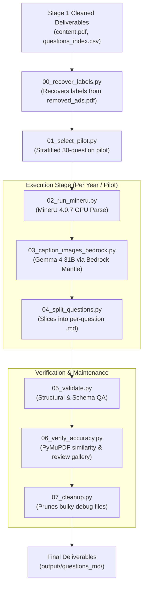

# MinerU & Bedrock Textbook Extraction Pipeline

A production-grade multimodal pipeline for distilling multi-year exam books and textbooks (specifically JEE Mains even years 2018–2026, comprising ~5,775 questions) into structured, individual Markdown question files.

The pipeline combines **MinerU 4.0.7** (running on local GPU in managed mode) for high-fidelity OCR, LaTeX math formula extraction, and table parsing with **Gemma 4 31B via AWS Bedrock Mantle** (OpenAI-compatible gateway) for deep multimodal figure description and faithful step-by-step solution image transcription.

---

## 🌟 Key Features

- **Document-Level MinerU Processing**: Executes MinerU once per year or working set on full PDFs rather than thousands of individual snippets, maximizing GPU throughput.
- **Dual-Purpose Image Processing**:
  - *Diagrams / Figures*: Produces rich, self-contained descriptions (points, axes, scales, geometric relations, circuit components) enabling text-only reasoning models to solve the problem without the visual asset.
  - *Baked-in Solutions*: Faithfully transcribes rendered equation blocks and worked solutions step-by-step into LaTeX/plain text (preventing training data truncation).
- **Deterministic Shift Label Recovery**: Automatically matches and recovers missing shift and paper labels from archived Table-of-Contents / divider pages (`removed_ads.pdf`) for edge-case years (e.g., 2026_jan and 2026_april).
- **Text-Marker Question Slicing**: Robust boundary detection handles overlapping page ranges (questions spanning pages 1–2, 2–3) and section transitions without boundary leaks into adjacent questions.
- **Stratified Pilot Testing**: Lean 30-question pilot mode operating on ~10MB working PDFs with balanced representation across Physics, Chemistry, and Mathematics.
- **Dual-Layer Quality Assurance**:
  - *Structural QA (`05_validate.py`)*: Validates question counts, non-empty files, frontmatter keys, and asset references.
  - *Content Accuracy Verifier (`06_verify_accuracy.py`)*: Performs an independent PyMuPDF text cross-check (SequenceMatcher similarity scoring), detects boundary leaks, missing answer markers, and broken LaTeX braces.
  - *Human Spot-Check Package*: Automatically renders original PDF pages as PNGs alongside generated Markdown in an interactive `review.md` table.
- **Safe Disk Cleanup**: Prunes heavy raw intermediate artifacts (layout previews, full-page debug renders) while preserving final question Markdown files and referenced image assets.

---

## 🏗️ Architecture & Pipeline Flow



---

## 📁 Repository Structure

```plaintext
minerU-textbook-extraction/
├── jee_mains_even_years_combined_deliverables/   # Cleaned input deliverables per year
│   ├── 2018/                                     # content.pdf, removed_ads.pdf, index CSVs
│   ├── 2020_jan/
│   ├── 2020_september/
│   ├── 2022_july/
│   ├── 2022_june/
│   ├── 2024_april/
│   ├── 2026_april/
│   └── 2026_jan/
├── scripts/                                      # Pipeline execution scripts
│   ├── 00_recover_labels.py                      # Shift & paper label recovery
│   ├── 01_select_pilot.py                        # Stratified pilot question sampler
│   ├── 02_run_mineru.py                          # MinerU parser launcher
│   ├── 03_caption_images_bedrock.py              # Multimodal image captioning client
│   ├── 04_split_questions.py                     # Markdown slicing & formatting
│   ├── 05_validate.py                            # Structural validation
│   ├── 06_verify_accuracy.py                     # Accuracy cross-check & review package
│   ├── 07_cleanup.py                             # Safe intermediate storage pruning
│   ├── inspect_mineru_output.py                  # MinerU calibration & debug tool
│   ├── run_pipeline.py                           # Master pipeline orchestrator
│   └── common/                                   # Shared core modules
│       ├── bedrock_client.py                     # Mantle/OpenAI SDK Bedrock interface
│       ├── config.py                             # Central configuration & env vars
│       ├── io_utils.py                           # Deliverable readers & ID sanitizers
│       ├── labels.py                             # Ad-page label matching algorithms
│       ├── mineru_adapter.py                     # MinerU CLI wrapper & locator parser
│       ├── pdf_utils.py                          # PyMuPDF rendering & page extraction
│       ├── reference_extract.py                  # Independent PyMuPDF text extractor
│       ├── scope.py                              # ScopeYear abstraction (pilot vs full)
│       └── slicing.py                            # Question boundary slicing engine
├── output/                                       # Generated outputs (checkpoints, reviews)
│   ├── _pilot/                                   # Pilot test deliverables & states
│   └── <year>/                                   # Production markdown & image assets
├── progress.md                                   # Comprehensive development & execution log
├── requirements.txt                              # Python package dependencies
└── README.md                                     # Project documentation
```

---

## ⚙️ Environment Setup & Prerequisites

### 1. Hardware & System
- **Recommended**: AWS EC2 / SageMaker instance with NVIDIA GPU (e.g., `g5.2xlarge` with NVIDIA A10G 24GB VRAM).
- **OS**: Linux (Ubuntu 22.04 / Amazon Linux 2) or Windows with Python 3.10+.
- **Disk Space**: At least 50GB free disk space recommended for full multi-year processing.

### 2. Python Dependencies
Install standard dependencies:
```bash
pip install -r requirements.txt
```

*Contents of `requirements.txt`:*
- `pymupdf`: PDF text extraction and page image rendering.
- `boto3`: AWS SDK utilities.
- `openai`: OpenAI Python client (used to interact with AWS Bedrock Mantle gateway).

### 3. MinerU Installation & Configuration
Install MinerU 4.0.7 on your GPU machine:
```bash
pip install -U "mineru[core]"
```

Configure MinerU for **local managed GPU inference** (avoiding unconfigured public cloud defaults):
```bash
# Download models (~3GB: layout, OCR, formula ONNX models + GGUF VLM)
mineru-kit models download --tier standard

# Set local execution mode to managed
mineru config set parse_server.local.mode managed

# Disable interactive telemetry prompt to allow non-interactive scripts
mineru telemetry disable
```

### 4. Environment Variables
Set the following environment variables before running multimodal captioning:

```bash
# AWS Bedrock Mantle Gateway (OpenAI-compatible)
export OPENAI_BASE_URL="https://bedrock-mantle.us-east-1.api.aws/openai/v1"
export OPENAI_API_KEY="<your-bedrock-api-key>"
export GEMMA_MODEL_ID="google.gemma-4-31b"
export AWS_REGION="us-east-1"

# (Optional) Concurrency & Worker Tuning
export BEDROCK_MAX_WORKERS="8"
export MINERU_TIER="standard"
```

---

## 🚀 Execution Guide

The pipeline is orchestrated via [`scripts/run_pipeline.py`](file:///scripts/run_pipeline.py), which handles checkpoints (`_state.json`) so crashed or stopped runs can resume seamlessly.

### Quickstart: 30-Question Pilot Run
Run the stratified pilot across all 8 exam years on the lightweight working set:
```bash
python scripts/run_pipeline.py --pilot
```
This parses only the 30 selected questions, extracts images, generates Gemma captions, slices questions into markdown, and creates a visual spot-check review gallery at `output/_pilot/<year>/review/review.md`.

### Single Year Production Run
Run the pipeline end-to-end for a specific year (e.g., `2026_jan`):
```bash
python scripts/run_pipeline.py --year 2026_jan
```

### Full Corpus Execution with Automated Cleanup
Process all 8 years sequentially, recovering labels, parsing PDFs, generating captions, validating, and cleaning intermediate files:
```bash
python scripts/run_pipeline.py --all --cleanup
```

### Useful CLI Flags
- `--force`: Re-run stages even if marked done in `_state.json`.
- `--skip-labels`: Skip label recovery if already computed.
- `--no-review`: Skip rendering PNG page comparisons in `06_verify_accuracy.py` for faster QA.

---

## 🔍 Quality Assurance & Review Framework

The pipeline implements an independent validation architecture:

1. **Structural QA (`05_validate.py`)**:
   - Confirms total generated question files match expected question counts in `questions_index.csv`.
   - Ensures no empty files and verifies required YAML frontmatter fields (`q_id`, `year`, `subject`, `paper`, `page_range`).
   - Verifies all referenced images exist in the corresponding `images/` folder.

2. **Content Accuracy Verifier (`06_verify_accuracy.py`)**:
   - Computes sequence similarity against an independent PyMuPDF text stream extracted directly from `content.pdf`.
   - Detects boundary leaks (ensures adjacent question headers such as `Q. 2` do not leak into `Q. 1`).
   - Identifies truncated solutions and flags missing answer markers (`Correct Answer:`).
   - Validates LaTeX bracket and brace balance.
   - Audits image captions against model refusal hints (e.g., `"I cannot assist"`) or repeated templated outputs.

3. **Human Spot-Check Gallery (`output/<scope>/<year>/review/review.md`)**:
   - Compares the rendered question Markdown alongside the original high-resolution rendered PDF page images.
   - Allows rapid visual auditing of complex mathematical proofs, chemical reactions, and diagram descriptions.

---

## 📝 Generated Markdown Schema

Each question is output as an isolated Markdown file:

```markdown
---
q_id: S04|Physics|Q009
year: 2018
subject: Physics
paper: 15th April 2018 Shift 1
page_range: [12, 13]
has_image: true
---

# Question 9

A particle of mass $m$ is moving in a circular path of constant radius $r$ such that its centripetal acceleration $a_c$ is varying with time $t$ as $a_c = k^2 r t^2$.


> **Image content:**
> The diagram shows a circular trajectory of radius $r$ in the x-y plane with a particle located at angle $\theta$. Tangential velocity vector $\vec{v}$ is perpendicular to radial acceleration vector $\vec{a}_c$.

(1) $2\pi k^2 m r^2 t$
(2) $k^2 m r^2 t$
(3) $\frac{1}{2} k^2 m r^2 t$
(4) $0$

**Correct Answer:** (2)

**Solution:**
Centripetal acceleration is given by:
$$a_c = \frac{v^2}{r} = k^2 r t^2 \implies v = k r t$$
Tangential acceleration $a_t = \frac{dv}{dt} = k r$.
Power delivered by the force:
$$P = F_t \cdot v = (m a_t) \cdot v = (m k r)(k r t) = m k^2 r^2 t$$
```

---

## 🛠️ Calibration & Diagnostics

To verify MinerU CLI and parser behavior on a new machine before running large batches:
```bash
python scripts/inspect_mineru_output.py
```
This utility parses a sample page, checks block parsing, verifies locator resolutions, and outputs raw block telemetry.

---

## 📜 Development History

For a complete chronological development log, architectural decisions, and edge-case resolutions (including MinerU 4.0.7 CLI changes and Bedrock Mantle integration details), refer to [`progress.md`](file:///progress.md).